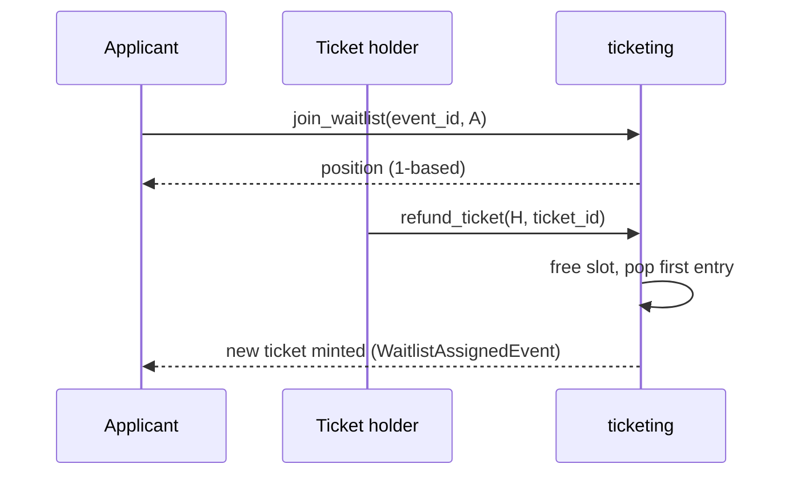

# Event waitlists

The standalone `ticketing` contract keeps a first-in-first-out waitlist per event. A user joins the waitlist once a capacity-limited event is full, and the first entry is promoted when a ticket is refunded. This page is for organizers and frontend developers building on [`contracts/ticketing`](../../contracts/ticketing/src/lib.rs).

## Why it exists

Capacity-limited events sell out. Without a queue, a refund frees a slot that the next fast caller takes. The waitlist gives refunded slots a deterministic order: earliest joiner first.

## How it works

1. A user calls `join_waitlist(event_id, applicant)` while the event is at capacity. The contract appends a `WaitlistEntry` and returns the applicant's 1-based position.
2. A ticket holder calls `refund_ticket(holder, ticket_id)`. The ticket is marked refunded and removed from the event's active list, which frees one slot.
3. In the same call, if the waitlist is not empty, the contract removes the first entry, mints that applicant a new untiered ticket, and publishes `WaitlistAssignedEvent`.

### Promotion is automatic

Promotion is automatic and happens inside `refund_ticket`. There is no organizer call to promote, skip, or reorder entries. The promoted ticket is untiered (`tier_id: None`), and its `qr_hash` is a placeholder derived from the refunded ticket ID and the ledger timestamp.

> **Warning:** The placeholder `qr_hash` is not a real check-in credential. Replace it off-chain before the event, as described in [`contracts/ticketing/src/lib.rs`](../../contracts/ticketing/src/lib.rs).

## Relevant types and storage

| Type / key | Defined in | Purpose |
|---|---|---|
| `WaitlistEntry { event_id, applicant, joined_at }` | [`contracts/ticketing/src/lib.rs#L106-L113`](../../contracts/ticketing/src/lib.rs#L106-L113) | One queue entry. `joined_at` is the ledger timestamp in seconds. |
| `DataKey::Waitlist(u64)` | [`contracts/ticketing/src/lib.rs#L130`](../../contracts/ticketing/src/lib.rs#L130) | `Vec<WaitlistEntry>` in persistent storage, one per event, in FIFO order. |
| `WaitlistJoinedEvent` | [`contracts/ticketing/src/lib.rs#L192-L198`](../../contracts/ticketing/src/lib.rs#L192-L198) | `event_id`, `applicant`, `position`, `timestamp`. |
| `WaitlistAssignedEvent` | [`contracts/ticketing/src/lib.rs#L216-L222`](../../contracts/ticketing/src/lib.rs#L216-L222) | `event_id`, `assignee`, `ticket_id`, `timestamp`. |

## Relevant functions

| Function | Signature | Purpose |
|---|---|---|
| `join_waitlist` | `fn join_waitlist(env: Env, event_id: u64, applicant: Address) -> u32` | Requires `applicant` auth. Appends the applicant and returns the 1-based position. |
| `get_waitlist` | `fn get_waitlist(env: Env, event_id: u64) -> Vec<WaitlistEntry>` | Read-only, no auth. Returns the queue in FIFO order, or an empty vector. |
| `refund_ticket` | `fn refund_ticket(env: Env, holder: Address, ticket_id: u64)` | Frees a slot and auto-promotes the first waitlisted applicant. |

## Preconditions and errors

`join_waitlist` checks in this order:

| Condition | Error | Code |
|---|---|---|
| Event does not exist | `EventNotFound` | 1 |
| Event has `max_capacity: None` | `NotAtCapacity` | 20 |
| Active (non-refunded) tickets are below `max_capacity` | `NotAtCapacity` | 20 |
| `applicant` is already in the queue for this event | `AlreadyOnWaitlist` | 21 |

Duplicates are detected by scanning the queue for an equal `applicant` address, so the check costs O(n) in queue length.

## Refunds and cancellations

| Action | Effect on the waitlist |
|---|---|
| `refund_ticket` with a non-empty waitlist | First entry is removed and receives a new ticket. Remaining entries move up one position. |
| `refund_ticket` with an empty waitlist | The slot stays free. Anyone can then buy it through the normal issue path. |
| `cancel_event` | The waitlist is not touched. Entries stay in storage. |

> **Warning:** `cancel_event` does not clear the queue, and `join_waitlist` does not check the event state. A cancelled event that is still at capacity accepts new waitlist entries, and `refund_ticket` on a cancelled event still promotes the first applicant. Frontends should hide the waitlist for cancelled events.

There is no `leave_waitlist` function. An applicant cannot remove themselves, and positions only change when the head is promoted.

## Organizer and frontend guidance

- Index `WaitlistJoinedEvent` and `WaitlistAssignedEvent` to notify users off-chain. `position` in the joined event is a snapshot and goes stale as the head is promoted.
- Show the live position by calling `get_waitlist` and finding the applicant's index plus one.
- After `WaitlistAssignedEvent`, tell the assignee a ticket was issued. Promotion does not wait for the user to accept.
- Replace the placeholder `qr_hash` for promoted tickets before check-in.
- Do not promise a payment flow here. The `ticketing` contract's `refund_ticket` does not move tokens. Handle any money return to the original holder, and any charge to the promoted user, in your own off-chain process.

## Privacy

Waitlist entries are public. Anyone can call `get_waitlist` and read every `applicant` address and `joined_at` timestamp, and the join and assignment events are public on the ledger. Do not link waitlist addresses to personal data in public indexes.

## Related pages

- [Ticketing contract reference](../contracts/ticketing.md)
- [Event ticketing, dynamic pricing, and resale](./event-ticketing.md)
- [Error reference](../reference/errors.md)
- [Event reference](../reference/events.md)
