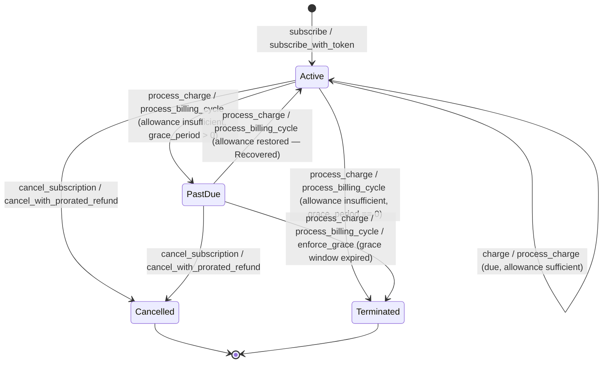

# Subscription grace periods and past-due handling

When a recurring charge fails for insufficient allowance, the standalone `subscription` contract (`contracts/subscription/`) doesn't drop the subscriber immediately — it enters a `PastDue` grace window sized by the plan, and only terminates once that window elapses without payment. This page documents every status, every transition, who can drive each one, and what events (if any) a merchant can observe off-chain.

> **Note:** This page covers the standalone `subscription` crate, not the Shade hub's own subscription feature, which has no grace period or `PastDue` concept at all (see [Subscriptions and recurring billing](./subscriptions.md) and the comparison table in the [contract reference](../contracts/subscription.md#relationship-to-shade)).

## Why it exists

A single missed payment — a lapsed card-equivalent allowance, a customer who hasn't topped up yet — shouldn't necessarily end a subscription outright. `Plan.grace_period` lets a merchant define how many seconds a subscription may sit `PastDue` before the contract gives up on it, trading "charge strictly, fail hard" (plain `charge()`) for a forgiving billing loop (`process_charge`/`process_billing_cycle`) that can recover a subscription if the customer restores their allowance in time.

## `set_plan_grace_period`

[`contracts/subscription/src/lib.rs`](../../contracts/subscription/src/lib.rs#L151-L165)

```rust
pub fn set_plan_grace_period(env: Env, merchant: Address, plan_id: u64, grace_period: u64)
```

- **Auth:** `merchant.require_auth()`, and the caller must be the plan's own `merchant` — panics `NotAuthorized` otherwise (verified by `test_non_merchant_cannot_set_grace_period`).
- **Storage:** writes `Plan.grace_period` (seconds) directly; there is no separate per-subscription override — every subscription on a plan shares that plan's current grace period.
- **Default is `0`** (`test_default_plan_grace_period_is_zero`) — a plan newly created via `create_plan` has no grace at all until the merchant explicitly calls this. With `grace_period == 0`, the very first failed charge terminates the subscription immediately; there is no `PastDue` stopover.
- **Applied read live, not snapshotted:** the grace period used to evaluate an in-flight `PastDue` subscription is always the plan's *current* `grace_period` at the moment `process_charge`/`process_billing_cycle`/`enforce_grace` runs — changing it mid-grace changes the deadline for every subscription currently past due on that plan, not just future ones.

## `SubscriptionStatus`

[`contracts/subscription/src/types.rs`](../../contracts/subscription/src/types.rs#L73-L85)

| Variant | Value | Meaning | Can be charged? | Terminal? |
|---|---|---|---|---|
| `Active` | 0 | Normal state; billing is current. | Yes | No |
| `PastDue` | 2 | A charge attempt failed while the subscription was `Active`, and the plan's `grace_period > 0`. Inside the grace window. | Only via the forgiving path (`process_charge`/`process_billing_cycle`); strict `charge()` panics. | No — recoverable |
| `Terminated` | 3 | The grace window expired without a successful charge. | No | **Yes — permanent** |
| `Cancelled` | 1 | Customer- or merchant-initiated cancellation. | No | **Yes — permanent** |

`Cancelled` and `Terminated` are deliberately two distinct terminal states, not one combined "inactive" outcome — neither can transition into the other, and neither can be recovered back to `Active`. A cancelled subscription was stopped on purpose; a terminated one lapsed for non-payment. Keep them separate in any off-chain access-control logic (e.g. "terminated" might warrant a dunning/win-back flow that "cancelled" shouldn't trigger).

## State diagram



Strict `charge(sub_id)` only ever operates on `Active` subscriptions — it panics `SubscriptionNotActive` if called on a `PastDue` subscription (`test_strict_charge_panics_on_past_due`) rather than entering, continuing, or resolving grace. Every `PastDue`/`Terminated` transition in the diagram above is driven exclusively by `process_charge`, `process_billing_cycle`, or `enforce_grace`.

## `enforce_grace(sub_id)`

[`contracts/subscription/src/lib.rs`](../../contracts/subscription/src/lib.rs#L529-L555)

```rust
pub fn enforce_grace(env: Env, sub_id: u64)
```

- **Who may call it:** anyone — there is no `require_auth` call at all. The function comment states explicitly "there's no value in restricting it," since it only ever moves a subscription further toward a state the grace window already mandates; it cannot charge, recover, or otherwise benefit the caller.
- **When it terminates:** only if the subscription is currently `PastDue` **and** `now > past_due_since + plan.grace_period`. Calling it before the window has elapsed panics `GraceNotExpired` (`test_enforce_grace_panics_during_grace_window`). Calling it on an `Active` subscription panics `SubscriptionNotActive` (`test_enforce_grace_panics_when_active`) — it only ever acts on subscriptions already past due.
- **Idempotent on an already-terminated subscription:** if `status == Terminated`, the call simply returns — no panic, no event, no state write (`test_enforce_grace_is_idempotent_on_already_terminated`). This makes it safe to call speculatively or repeatedly from automation without first checking status.
- **Why termination is permanent:** nothing in this contract (or anywhere in the `subscription` crate) transitions `Terminated` back to any other status. There is no "reinstate" function. A customer whose subscription terminates must `subscribe` (or `subscribe_with_token`) again to create a brand-new subscription record — the old `sub_id`'s history (`last_charged`, prior cycles) is not carried forward.

`enforce_grace` exists primarily so termination doesn't have to wait on the next scheduled billing attempt: an off-chain process (or anyone) can close out an expired grace window the moment it lapses, rather than leaving a dead `PastDue` record sitting around until the next `process_charge`/`process_billing_cycle` call happens to touch it.

## Recovery

If the customer restores a sufficient token allowance (via `authorize_billing` — see [Subscription billing authorization and allowances](./subscription-billing-authorization.md)) before the grace window elapses, the **next** `process_charge`/`process_billing_cycle` call on that subscription:

1. Successfully pulls the charge (`try_pull_charge` finds `allowance >= plan.amount`).
2. Sets `status = Active`, `last_charged = now`, `past_due_since = 0`.
3. Returns `ChargeOutcome::Recovered`.

This is the forgiving path's success-from-`PastDue` branch in `step_billing_cycle` ([`contracts/subscription/src/lib.rs`](../../contracts/subscription/src/lib.rs#L783-L827)) — the same underlying `try_pull_charge` the `Active` branch uses, just with different bookkeeping around it (`past_due_since` reset, status flip). Repeated failed checks during the window do **not** reset or extend `past_due_since`: the deadline is fixed the moment grace begins, not a rolling window that restarts on every poke (`test_past_due_within_grace_keeps_state_unchanged_when_still_short`).

A `PastDue` subscription can still be read (`get_subscription`) and cancelled (`cancel_subscription`/`cancel_with_prorated_refund` both accept `PastDue`) without first recovering — a customer in grace isn't locked out of exiting cleanly.

## Events

The `subscription` crate defines exactly two event types ([`contracts/subscription/src/types.rs`](../../contracts/subscription/src/types.rs#L1-L19)):

| Event | Fields | Emitted by |
|---|---|---|
| `SubRenewed` | `subscription_id`, `plan_id`, `customer`, `timestamp` | `charge`, `process_charge`/`process_billing_cycle` on `Charged`, `Recovered`, and `upgrade_subscription` |
| `SubExpired` | `subscription_id`, `plan_id`, `customer`, `timestamp` | `cancel_subscription`, `cancel_with_prorated_refund`, `process_charge`/`process_billing_cycle` on `Terminated`, and `enforce_grace`'s termination branch |

Mapped onto the grace lifecycle specifically:

| Transition | Event emitted |
|---|---|
| **Entering grace** (`Active` → `PastDue`) | **None.** `step_billing_cycle`'s `EnteredGrace` branch writes `status`/`past_due_since` but publishes no event. |
| **Recovery** (`PastDue` → `Active`) | `SubRenewed` |
| **Termination** (`PastDue` → `Terminated`, via `process_charge`/`process_billing_cycle`/`enforce_grace`) | `SubExpired` |

> **Warning:** There is no event for a subscription entering `PastDue`. A merchant driving access control purely off emitted events will see a subscription go quiet (no new `SubRenewed`) but will not see a positive signal that it specifically entered grace rather than, say, simply not being due yet. To detect "just entered grace," either read the `ChargeOutcome::EnteredGrace` return value directly from the `process_charge`/`process_billing_cycle` call that caused it (see the [Billing Keeper Operator Guide](../operations/billing-keeper.md)), or poll `get_subscription(sub_id).status` off-chain. Don't design an indexer that assumes every status transition has a matching event — two of the four transitions into/out of `PastDue` do, one does not, and `Cancelled` also emits `SubExpired` (the same event type `Terminated` uses), so `SubExpired` alone cannot distinguish cancellation from grace expiry without also checking the subscription's resulting `status`.

## Test cross-reference

Every rule above is backed by a specific test in [`contracts/subscription/src/test_grace.rs`](../../contracts/subscription/src/test_grace.rs):

| Behavior | Test |
|---|---|
| Default grace period is zero | `test_default_plan_grace_period_is_zero` |
| Only the plan's merchant can set grace period | `test_non_merchant_cannot_set_grace_period`, `test_set_plan_grace_period_updates_value` |
| Zero-grace plan terminates on first failed charge | `test_failed_charge_with_zero_grace_terminates_immediately` |
| Non-zero grace enters `PastDue` with `past_due_since` set | `test_failed_charge_with_grace_enters_past_due` |
| `past_due_since` doesn't reset on repeated in-window checks | `test_past_due_within_grace_keeps_state_unchanged_when_still_short` |
| Recovery via restored allowance | `test_past_due_recovery_when_allowance_restored`, `test_process_billing_cycle_recovers_past_due_when_allowance_restored` |
| Termination once the window elapses | `test_past_due_terminates_after_grace_expires`, `test_process_billing_cycle_drives_grace_to_termination` |
| `process_charge` panics on an already-terminated/cancelled subscription | `test_process_charge_panics_on_terminated`, `test_process_charge_panics_on_cancelled` |
| Strict `charge()` rejects a `PastDue` subscription | `test_strict_charge_panics_on_past_due` |
| `enforce_grace` termination, idempotency, and preconditions | `test_enforce_grace_terminates_after_window`, `test_enforce_grace_is_idempotent_on_already_terminated`, `test_enforce_grace_panics_during_grace_window`, `test_enforce_grace_panics_when_active` |
| Batch processing tolerates mixed/terminal entries | `test_process_billing_cycle_returns_skipped_for_cancelled`, `test_process_billing_cycle_returns_skipped_for_terminated`, `test_process_billing_cycle_handles_mixed_outcomes`, `test_process_billing_cycle_does_not_panic_on_terminal_entries` |

## Related pages

- [Subscription billing authorization and allowances](./subscription-billing-authorization.md) — how `authorize_billing` and a restored allowance drive recovery.
- [Subscription contract reference](../contracts/subscription.md) — full type, function, and error listing, including the transition reference table this page's diagram is drawn from.
- [Billing Keeper Operator Guide](../operations/billing-keeper.md) — the off-chain process that actually calls `process_charge`/`process_billing_cycle` and reacts to `ChargeOutcome`.
- [Events reference § `subscription` contract](../reference/events.md#subscription-contract) — `SubRenewed`/`SubExpired` alongside every other event in the workspace.
- [Subscriptions and recurring billing](./subscriptions.md) — the Shade hub's own subscription feature, which has no grace period or `PastDue` state at all.
