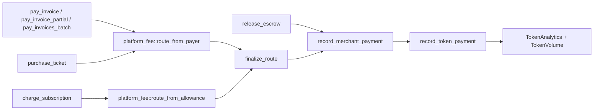

# Token analytics and market share metrics

The Shade hub keeps protocol-wide counters per token, separate from the per-[merchant](../glossary.md#merchant) analytics. This page defines each token analytics function, which payments feed the counters, the market-share unit, and the cost limits of the list queries. It is for dashboard and indexer developers.

## Why it exists

Token metrics answer protocol questions that merchant analytics cannot: how much volume each accepted token carries, and how dominant a token is across all merchants. The counters are read directly from the contract with no indexer, at the price of the limits listed below.

## How it works

Every payment that goes through the platform fee router calls `record_merchant_payment`, which also calls the internal `record_token_payment`. That function adds the gross amount and the platform fee to the token's `TokenAnalytics`, and mirrors `total_volume` into `DataKey::TokenVolume(token)` for cheap single-value reads.



## Volume accounting

Volume is **gross** and **increment-only**. Each recorded payment adds the full amount the payer paid (before the platform fee is split off) to `total_volume`, and adds the platform fee to `total_fees`.

| Event | Counted in token volume | Notes |
|---|---|---|
| `pay_invoice` (full payment) | Yes | Pays the remaining balance through `pay_invoice_partial_inner`. |
| `pay_invoice_partial` | Yes | Each partial payment is one recorded payment, with its own `transaction_count` increment. |
| `pay_invoices_batch` | Yes | One recorded payment per invoice in the batch. |
| `purchase_ticket` | Yes | Hub event ticketing, at the current dynamic price. |
| `charge_subscription` | Yes | Hub subscription charge, at `plan.amount`. |
| `release_escrow` | Yes | Counts the escrow `amount`; the fee is `calculate_fee` on that amount. |
| `purchase_tickets_bulk` | **No** | Transfers the discounted total directly; skips the fee router. |
| `resell_ticket`, `buy_ticket_from_listing` | **No** | Secondary-market royalty split; skips the fee router. |
| `refund_invoice`, `refund_invoice_partial`, `refund_escrow` | **No decrement** | Refunds never reduce any counter. |
| `cancel_event_and_batch_refund` | **No decrement** | Ticket refunds never reduce any counter. |
| Standalone `subscription` and `ticketing` contracts | No | They are separate contracts and do not write hub storage. |

> **Note:** Because refunds do not decrement, `total_volume` is gross processed volume, not net revenue. Compute net figures off-chain from refund events.

> **Warning:** [Merchant analytics and transaction history](./analytics-and-history.md) states that ticket purchases are not counted. `purchase_ticket` does route through `route_from_payer` with `PlatformFeeRouteKind::TicketPurchase`, so it is counted. Bulk purchases and resales are the ticket flows that are not.

## Relevant types and storage

| Type / key | Defined in | Purpose |
|---|---|---|
| `TokenAnalytics` | [`contracts/shade/src/types.rs#L534-L543`](../../contracts/shade/src/types.rs#L534-L543) | Per-token aggregate returned by `get_token_analytics`. |
| `DataKey::TokenAnalytics(Address)` | [`contracts/shade/src/types.rs#L76`](../../contracts/shade/src/types.rs#L76) | Persistent storage for the aggregate. |
| `DataKey::TokenVolume(Address)` | [`contracts/shade/src/types.rs#L77`](../../contracts/shade/src/types.rs#L77) | Copy of `total_volume`, read by the volume and share queries. |

### TokenAnalytics fields

| Field | Type | Meaning |
|---|---|---|
| `token` | `Address` | The token contract address. |
| `total_volume` | `i128` | Sum of gross payment amounts, in token base units. |
| `total_fees` | `i128` | Sum of platform fees, in token base units. |
| `transaction_count` | `u64` | Number of recorded payments, including each partial payment. |
| `unique_merchants` | `u64` | See the warning below. |
| `last_updated` | `u64` | Ledger timestamp of the last recorded payment, in seconds. |

For a token with no payments, `get_token_analytics` returns all-zero fields with `token` set; it does not panic.

> **Warning:** `unique_merchants` is not a distinct-merchant count. `record_token_payment` increments it only when the token's stored volume is `0` at the time of the payment, so it is `1` for any token that has had a payment and effectively never grows. Count distinct merchants off-chain from `PlatformFeeRoutedEvent`.

## Relevant functions

All five are read-only, require no authorization, and are declared in [`contracts/shade/src/interface.rs#L322-L335`](../../contracts/shade/src/interface.rs#L322-L335). Implementations are in [`contracts/shade/src/components/admin.rs#L280-L389`](../../contracts/shade/src/components/admin.rs#L280-L389).

| Function | Signature | Returns |
|---|---|---|
| `get_token_analytics` | `fn get_token_analytics(env: Env, token: Address) -> TokenAnalytics` | The aggregate, or zeros. |
| `get_token_volume` | `fn get_token_volume(env: Env, token: Address) -> i128` | `total_volume` in base units, or `0`. |
| `get_token_dominance_metrics` | `fn get_token_dominance_metrics(env: Env, tokens: Vec<Address>) -> Vec<(Address, i128)>` | `(token, volume)` for each input token, sorted by volume descending. |
| `get_top_tokens_by_volume` | `fn get_top_tokens_by_volume(env: Env, limit: u32) -> Vec<(Address, i128)>` | The same sorted list over all accepted tokens, truncated to `limit`. |
| `get_token_market_share` | `fn get_token_market_share(env: Env, token: Address) -> i128` | Share of total accepted-token volume, in basis points. |

### Ordering and edge cases

- `get_token_dominance_metrics` returns one entry per input element, including duplicates and tokens with no volume (volume `0`). It does not check that tokens are accepted. Ties keep input order.
- `get_top_tokens_by_volume` reads the accepted-token whitelist, so a token that was removed from the whitelist is excluded even if it has volume. `limit = 0` returns an empty vector. A `limit` larger than the list returns the whole list.

## Market share unit and rounding

`get_token_market_share` returns **basis points**: `10000` means 100%, `2500` means 25%.

```
share_bps = (token_volume * 10_000) / total_volume
```

`total_volume` is the sum of `get_token_volume` over the **currently accepted** tokens. Integer division truncates toward zero, so each share rounds **down** and the shares of all tokens can sum to less than `10000`. It returns `0` when the token has no volume or when the accepted-token total is `0`.

> **Warning:** Volumes are in each token's own base units, and the formula does not normalize decimals or convert to a common currency. A 7-decimal token and a 6-decimal token are summed as raw integers. Treat share as meaningful only across tokens with comparable decimals and value, or recompute it off-chain with prices.

> **Warning:** If a token has volume but was removed from the whitelist, `total_volume` excludes it. Its share is then computed against a smaller denominator and can exceed `10000`, or return `0` if no accepted token has volume.

The multiplication is checked: the workspace [`Cargo.toml`](../../Cargo.toml) sets `overflow-checks = true`, so an `i128` overflow traps the call instead of wrapping.

## Cost and limits

None of these functions is paginated. Each loops over its input or over the whole whitelist and reads one persistent entry per token.

| Function | Work per call |
|---|---|
| `get_token_volume`, `get_token_analytics` | One read. |
| `get_token_market_share` | One read, then one read per accepted token, plus a full whitelist read. |
| `get_token_dominance_metrics(tokens)` | One read per input token, then an insertion sort with O(n²) comparisons and writes on the in-memory vector. |
| `get_top_tokens_by_volume(limit)` | The dominance work over **all** accepted tokens, regardless of `limit`. `limit` only trims the result. |

The whitelist is unbounded in code, so there is no contract-side cap on `n`. Soroban meters CPU instructions and ledger reads per invocation, so a large whitelist or a large `tokens` argument can exceed the transaction or simulation budget and fail. Keep `tokens` to a few dozen entries, and expect `get_top_tokens_by_volume` to cost the same for `limit = 1` as for `limit = 100`.

> **Note:** `get_token_market_share` called once per token costs O(n²) reads across a full dashboard. Fetch volumes once with `get_token_dominance_metrics` and compute shares client-side.

## Example dashboard query sequence

1. `get_top_tokens_by_volume(10)` returns the leaderboard `(token, volume)` pairs. One call, sorted.
2. For each token on screen, `get_token_analytics(token)` returns fees, `transaction_count`, and `last_updated`.
3. Compute share client-side: `share_bps = volume * 10_000 / sum(volumes)`, with integer division to match the contract. Call `get_token_market_share(token)` only to spot-check a single token.
4. Format volumes using each token's decimals; see [Amounts, token decimals, and rounding](./amounts-and-rounding.md).

## What to compute off-chain

| Metric | Reason |
|---|---|
| Net volume after refunds | The contract never decrements. Use refund events. |
| Distinct merchants per token | `unique_merchants` does not count distinct merchants. |
| Time-windowed volume (daily, weekly) | Only lifetime totals are stored. |
| Cross-token share in a common currency | The contract mixes raw base units. |
| Volume from bulk ticket sales and resales | These flows are not recorded. |
| Rankings over a large whitelist | The on-chain sort is O(n²) and unpaginated. |

See [Indexing events](../guides/indexing-events.md) for the event stream to build these from.

## Related pages

- [Merchant analytics and transaction history](./analytics-and-history.md)
- [Fees, volume discounts, and time-locked fee changes](./fees.md)
- [Payment flows: full, partial, and batch](./payments.md)
- [Token whitelisting](./token-whitelisting.md)
- [Amounts, token decimals, and rounding](./amounts-and-rounding.md)
